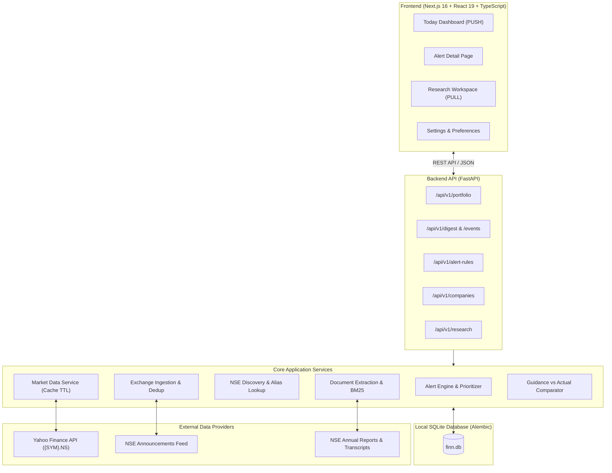

# FINN — Financial Investment Research Assistant

> **AI Engineer Build Challenge Submission**  
> Developed for **ENAM Holdings** · November 2026  
> Author: Candidate Submission

FINN is an AI-powered, mobile-first financial intelligence assistant for Indian equities (NSE/BSE). Designed for professional analysts and portfolio managers, FINN unifies two fundamental investment research paradigms into a cohesive workflow:

1. **PUSH (Proactive Monitoring):** Watches an 18-stock portfolio (13 sectors, large to small cap) using live NSE filings and end-of-day prices. It classifies every filing with the reference taxonomy and collapses routine ones. It reads results PDFs into a QoQ/YoY first cut (Revenue, EBITDA, PBT, PAT) and pulls the disclosed profile of incoming or outgoing executives. It fires triggered alerts when volume or the daily move crosses thresholds you set. Duplicate NSE/BSE filings are merged.
2. **PULL (Grounded On-Demand Research):** Enables deep research on any NSE-listed company using official annual reports and earnings-call transcripts. Features 6 specialized research lenses, natural-language question answering grounded in primary sources, page-level citations (`#page=X`), trajectory shift detection, strict banking guidance domain policies, and a 4-quarter Guidance vs Actual worked comparison.

## Submission at a glance

| Deliverable | Where |
| :--- | :--- |
| 📱 Live prototype (open on a phone) | **https://finn-c0t0.onrender.com** — free tier sleeps when idle; first load can take ~1 min |
| 💻 Repository | https://github.com/kumargulshann/finn |
| 🤖 AI build history | [`build-history/`](build-history/README.md) — 6 sessions across Antigravity, Codex and Claude Code, including abandoned attempts |
| ✉️ Writeup | [`SUBMISSION.md`](SUBMISSION.md) — what I built, trade-offs, what I left out, what's next |

**60-second phone tour:** *Today* → tap **30d** → open a **Results** card (QoQ/YoY table read from the filing, with its page) → back → open a **Management changes** card (profile from the filing) → *Settings*, raise *Unusual volume* to 3.0× → *Today* (weaker triggers drop out) → *Research* → Infosys → **Guidance vs Actual** → tap any page citation.

### Deploying

The repo ships a single [`Dockerfile`](Dockerfile): Next.js (standalone) serves the UI on `$PORT` and proxies `/api/v1/*` to FastAPI on loopback. On first boot, a pre-indexed SQLite snapshot ([`backend/seed/finn.db`](backend/seed/finn.db): 14 filings, ~6.5k page chunks) is copied in, so research works even if NSE blocks the host's IP.

- **Render:** New → Blueprint → pick this repo ([`render.yaml`](render.yaml) is picked up automatically).
- **Hugging Face Spaces / Fly / Railway / any Docker host:** build the Dockerfile; it listens on `$PORT` (default 7860).

---

## 1. System Architecture

FINN is built with a modular, full-stack architecture that cleanly separates client presentation, backend processing, data persistence, and external exchange/market integrations.



### Technology Stack
- **Frontend:** Next.js (App Router), React, TypeScript, Tailwind CSS. Dark fintech aesthetic optimized for a 390px mobile viewport and responsive desktop layouts.
- **Backend:** Python 3.12, FastAPI, SQLAlchemy 2.0 (async/sync session management), Alembic migrations, Pydantic v2 schemas.
- **Database:** SQLite (`backend/data/finn.db`) with relational tables for companies, instruments, portfolios, announcements, financial metrics, alert rules, daily prices, research documents, and page-level chunks.
- **Document & Text Retrieval:** PyMuPDF (fitz) for PDF page extraction, BM25 lexical ranker with query expansion and stop-word filtering, regex-based metric and guidance extraction.
- **Market Data:** `yfinance` with automated caching, stale-quote fallback, and timestamp tracking.

---

## 2. Directory Structure

```text
E:\EnamFinal\
├── .gitignore                      # Root Git ignore rules (clean repository setup)
├── README.md                       # Complete project guide, documentation & walkthroughs
├── REQUIREMENTS.md                 # Product specifications and challenge requirements
├── PRODUCT_PLAN.md                 # Product roadmap and MVP definition
├── TECHNICAL_ARCHITECTURE.md       # Detailed architectural specifications
├── IMPLEMENTATION_ROADMAP.md       # Phased engineering implementation history
│
├── backend/                        # FastAPI application
│   ├── alembic.ini                 # Alembic configuration
│   ├── pyproject.toml              # Python dependencies and package metadata
│   ├── app/
│   │   ├── main.py                 # FastAPI application factory and lifespan hooks
│   │   ├── config.py               # Settings management via pydantic-settings
│   │   ├── api/routes/             # REST API routers (portfolio, digest, research, etc.)
│   │   ├── domain/models.py        # SQLAlchemy relational data models
│   │   ├── db/                     # Engine, session factory, and Alembic migrations
│   │   ├── integrations/           # Adaptors for NSE announcements, PDFs, and yfinance
│   │   └── services/               # Business logic: alert engine, company discovery,
│   │                               # research synthesis, guidance vs actual
│   ├── data/                       # SQLite database file (finn.db)
│   └── tests/                      # Automated test suite (core API, E2E, health)
│
└── frontend/                       # Next.js App Router application
    ├── package.json                # Frontend dependencies and scripts
    ├── tsconfig.json               # TypeScript configuration
    ├── next.config.ts              # Next.js build configuration (webpack WASM fallback)
    ├── app/                        # Pages: Today (/), Alert Detail (/events/[id]),
    │                               # Research (/research), Settings (/settings)
    ├── components/                 # Reusable UI components: AlertCard, AppShell, etc.
    └── lib/                        # Type definitions and API fetch client
```

---

## 3. Getting Started & Local Setup

### Prerequisites
- **Python:** 3.11 or newer (tested with Python 3.12)
- **Node.js:** 20.9 or newer (tested with Node.js 22+)
- **Git**

### Step 1: Clone and Configure Environment

```powershell
# From the repository root in PowerShell:
Copy-Item backend/.env.example backend/.env
Copy-Item frontend/.env.example frontend/.env.local
```

The defaults connect the frontend to `http://localhost:8000` and configure the database at `backend/data/finn.db`.

### Step 2: Install Backend Dependencies

```powershell
Set-Location backend
python -m venv .venv
.\.venv\Scripts\Activate.ps1
python -m pip install --upgrade pip
pip install -e ".[dev]"
Set-Location ..
```

### Step 3: Install Frontend Dependencies

```powershell
Set-Location frontend
npm install
Set-Location ..
```

### Step 4: Run the Application

Open two terminal sessions at the repository root:

**Terminal 1 — Backend API Server:**
```powershell
Set-Location backend
.\.venv\Scripts\Activate.ps1
uvicorn app.main:app --reload --host 127.0.0.1 --port 8000
```
*API will start at `http://127.0.0.1:8000`. Automatic migrations and demo seeds run on startup. Interactive API docs are available at `http://127.0.0.1:8000/docs`.*

**Terminal 2 — Frontend Application:**
```powershell
Set-Location frontend
npm run dev
```
*Frontend will start at `http://localhost:3000`.*

---

## 4. Verification & Automated Test Suite

To run all automated verification checks across backend and frontend:

```powershell
# 1. Run all Backend Pytest Suites (13 tests)
Set-Location backend
.\.venv\Scripts\Activate.ps1
pytest -v

# 2. Run Frontend Typecheck, Lint, and Production Build
Set-Location ..\frontend
npm run typecheck
npm run lint
npm run build
```

**Test Coverage Summary:**
- `test_core_api.py`: Covers the 18-holding portfolio with one batched quote request, EOD triggers and threshold re-filtering, and holdings edits surviving restarts. It also runs results-PDF parsing (QoQ/YoY, EBITDA, page) and executive-profile extraction on generated PDFs, plus classification, routine collapsing, NSE/BSE dedup, research retrieval and coverage outside the portfolio.
- `test_e2e_workflow.py`: Comprehensive end-to-end integration test validating the complete PUSH and PULL user journeys, alert priority scoring, threshold filtering, multi-quarter Guidance vs Actual matching, and banking guidance domain policies.
- `test_health.py`: Validates service availability and database connectivity.

---

## 5. API Reference

All endpoints are versioned under `/api/v1` (except `/health`):

| Method | Endpoint | Description |
| :--- | :--- | :--- |
| `GET` | `/health` | Service health check and database query test. |
| `GET` | `/api/v1/portfolio` | Retrieve tracked portfolio holdings, weights, and live market quotes. |
| `PUT` | `/api/v1/portfolio/holdings/{symbol}` | Enable or disable a company in the tracked portfolio. |
| `GET` | `/api/v1/digest` | Retrieve prioritized corporate alerts and announcements for a time window (`24 hours`, `7 days`, `30 days`). |
| `GET` | `/api/v1/events/{id}` | Retrieve comprehensive alert details, "Why it matters", event facts, and filing source links. |
| `PATCH`| `/api/v1/events/{id}` | Toggle bookmark (`is_saved`) or read (`is_read`) status for an event. |
| `GET` | `/api/v1/alert-rules` | List alert categories, enabled states, and sensitivity thresholds. |
| `PATCH`| `/api/v1/alert-rules/{id}` | Update alert rule sensitivity (e.g. volume spike threshold multiplier) or enabled state. |
| `POST` | `/api/v1/announcements/refresh` | Ingest NSE/BSE filings for the portfolio, classify, deduplicate, and parse results / management-change PDFs (runs every 4h in Docker). |
| `GET` | `/api/v1/companies` | Search company universe by symbol prefix, name substring, or conversational alias. |
| `GET` | `/api/v1/companies/{id}` | Get detailed company profile, exchange instruments, filing count, and live quote. |
| `GET` | `/api/v1/companies/{id}/prices` | Get cached daily OHLCV historical bars (`5d`, `1mo`, `3mo`, `6mo`, `1y`, `2y`). |
| `POST` | `/api/v1/research/documents/refresh`| Fetch, extract, and index official annual reports and earnings-call transcripts from NSE. |
| `GET` | `/api/v1/companies/{id}/research/documents` | List indexed documents, fiscal periods, page counts, and publication dates. |
| `POST` | `/api/v1/research/answer` | Sourced research QA across 6 investment lenses with page-level citations. |
| `POST` | `/api/v1/research/guidance-vs-actual` | Compare management guidance vs reported actuals across quarters with unit matching. |

---

## 6. Interactive Demo Walkthrough Scenarios

Follow these scenarios in the web UI at `http://localhost:3000` to review FINN's core capabilities:

### Scenario 1: PUSH — the digest
1. Open the app on a phone (or at 390px). **Today** opens on the 24h window; switch between **24h / 7d / 30d**.
2. **What matters** lists only material items, ranked by event type, financial magnitude (e.g. how big the PAT surprise is), portfolio weight and recency. Routine filings (earnings-call notices, investor meets, dividends, newspaper ads, compliance certificates) are counted and collapsed at the bottom; tap to expand.
3. Switch to **30d** and open a **Results** card, e.g. Reliance, L&T, TCS, Asian Paints, ITC, NTPC or Sun Pharma:
   - The card shows Revenue and PAT **QoQ and YoY** chips.
   - The detail page has the **first-cut table**: Revenue, EBITDA (derived), PBT and PAT for this quarter, last quarter and a year ago. It is read from the results table in the filing PDF, with a link to the exact page.
   - Columns are matched to periods by their header dates and cross-checked against the total-income line. If a filing can't be verified (Maruti, Dixon, banks and NBFCs), FINN says so instead of showing numbers.
4. Open a **Management changes** card (e.g. NTPC, Dixon, UltraTech, Bajaj Finance). **Who is it?** shows the incoming or outgoing person's profile as disclosed in the filing (SEBI requires one), with its page and a LinkedIn search link. FINN does not write bios from memory.

### Scenario 2: PUSH — triggered alerts you control
1. The **EOD monitor** (right column on desktop, below the digest on a phone) shows every holding's last move and its volume as a multiple of the 20-day average. Highlighted rows have crossed your thresholds.
2. Each **Price move** alert says whether the company filed anything that session ("no disclosed catalyst" vs a link to the same-day filing).
3. Open **Settings → Triggers**. Raise *Unusual volume* from 2.0× to 3.0× and *Large daily move* from 4% to 7%, then go back to **Today**: weaker triggers disappear immediately. Lower them again and they come back. Category toggles (Results, M&A, Management changes…) filter the digest the same way.

### Scenario 3: PULL — 4-Quarter Guidance vs Actual Analysis (Worked Example)
1. Navigate to **Research** (`/research`).
2. In the company search bar, select or type `INFY` (Infosys).
3. In the lens selector, select **Guidance vs Actual**.
4. Click **Compare four quarters** (or use *Fetch four quarters* if indexing fresh transcripts).
5. Review the resulting comparison table across four consecutive quarters (**Q2 FY27**, **Q1 FY27**, **Q4 FY26**, **Q3 FY26**):
   - For each quarter, observe the extracted operating margin target (e.g. `20%`) compared against reported actual margin (e.g. `21.0%`–`21.2%`).
   - Observe the computed variance (`+1.0%`, `+1.1%`, etc.).
   - Notice that both the guided target and the actual figure provide clickable source citations linking directly to the specific transcript page (e.g., *INFY Earnings Call Transcript · p. 4*).

### Scenario 4: PULL — Grounded Research Across Investment Lenses
1. On the **Research** workspace for Infosys, select the **Management Guidance** lens.
2. Ask: *"What is management guidance on revenue growth and operating margin?"*
3. Click **Run research**:
   - Notice the **SUFFICIENT EVIDENCE** badge.
   - Read the structured response: Executive Summary, Key Sourced Claims, Conflicting Disclosures, and Evidence Assessment.
   - Observe the **Discrepancy / Trajectory Shift Detected** callout highlighting how constant-currency revenue guidance ranges shifted across quarters.
   - Inspect the **Cited passages** block at the bottom, verifying that each excerpt links to `#page=X` in the original exchange PDF.
4. Switch to the **Bull vs Bear Analysis** lens and run research:
   - Observe how retrieved evidence is partitioned into *Potentially supportive disclosures* vs *Risks or counterpoints disclosed*.

### Scenario 5: PULL — Ad-Hoc Company Coverage & Truthful Evidence Gaps
1. In the Research company search input, search for a company outside the demo portfolio, such as `SBIN` (State Bank of India) or `HUL` (Hindustan Unilever).
2. Select the company:
   - Observe that FINN displays live Yahoo Finance market data and OHLCV history for the company.
   - Notice that **Indexed source documents** indicates `0 indexed` and *"no documents indexed yet"*.
3. Run a research query (e.g. *"What is management outlook on credit costs?"*):
   - Observe that FINN displays **INSUFFICIENT EVIDENCE** with an explicit evidence gap:  
     > *"No source documents are currently indexed for State Bank of India. FINN cannot provide a grounded answer without primary filings."*
   - Verify that FINN **refuses to fabricate or hallucinate** missing figures, citations, or quarters.

### Scenario 6: PULL — Banking Guidance Policy Enforcement
1. In Research, select `ICICIBANK` (ICICI Bank).
2. Select **Management Guidance** and ask: *"What guidance did management provide on credit costs and loan growth?"*
3. Observe FINN's domain-specific policy:
   > *"ICICI Bank does not publish forward-looking numerical quarterly guidance on loan growth, credit costs, or net interest margin in its earnings conference calls. While analysts enquire about guidance, management maintains a risk-calibrated underwriting stance rather than a quantitative budget target."*

---

## 7. Data Sources & Limitations

### Data Sources
1. **Corporate Announcements Feed:** Ingests public corporate announcement feeds from NSE and BSE. Captures regulatory updates, quarterly results notices, board appointments, order wins, acquisitions, and dividend announcements.
2. **Company Filings & Transcripts:** Indexes official PDF annual reports and quarterly earnings conference call transcripts filed with NSE.
3. **Market Data:** EOD equity quotes and historical OHLCV bars via Yahoo Finance (`{SYMBOL}.NS`), cached in SQLite with a 15-minute default TTL.

### Known System Limitations
1. **Portfolio Valuation & Absolute P&L:** The demo portfolio specifies percentage weights but does not define explicit share position quantities (e.g., 500 shares). Rather than inventing synthetic portfolio values, FINN truthfully labels aggregate portfolio value and rupee P&L as `"Unavailable"`, reporting live per-share quotes instead.
2. **BSE Scraping Restrictions:** Automated scrapers querying public BSE feeds frequently encounter HTTP 403 blocks (bot protection). NSE feeds ingest cleanly; for enterprise production, a contracted exchange feed (e.g., BSE Direct Feed / NSE SFTP) is recommended.
3. **Scanned / Raster PDFs:** Scanned PDFs lacking an embedded text layer (such as older Bharti Airtel annual reports) are detected and flagged as unreadable. FINN refuses to invent text for image-only pages; OCR preprocessing (e.g., Tesseract) would be required to extract them.
4. **Extractive Retrieval vs Generative LLM:** Research QA currently uses deterministic lexical extraction (BM25) with structured heuristic synthesis to guarantee 100% auditable grounding without hallucination. The backend is designed with a provider-neutral interface ready for direct connection to an LLM (e.g. Gemini 1.5 Pro) for natural language rephrasing.
5. **Results parsing coverage:** The first-cut parser handles the standard SEBI results table. In the live 30-day sample it verified 8 of 13 non-bank results filings. Banks and NBFCs (interest earned / provisions format) and unusual layouts (e.g. Maruti, Dixon) are marked "not available" with the reason, and the filing link stays one tap away.
6. **Executive profiles come only from the filing:** When a disclosure carries no profile, FINN names the person and offers a LinkedIn *search link*. It never scrapes LinkedIn or writes a bio from model memory.
7. **Push is in-app:** Triggers are evaluated on end-of-day data whenever Today loads, and filings refresh every 4 hours in the deployed container. There are no phone notifications yet.
